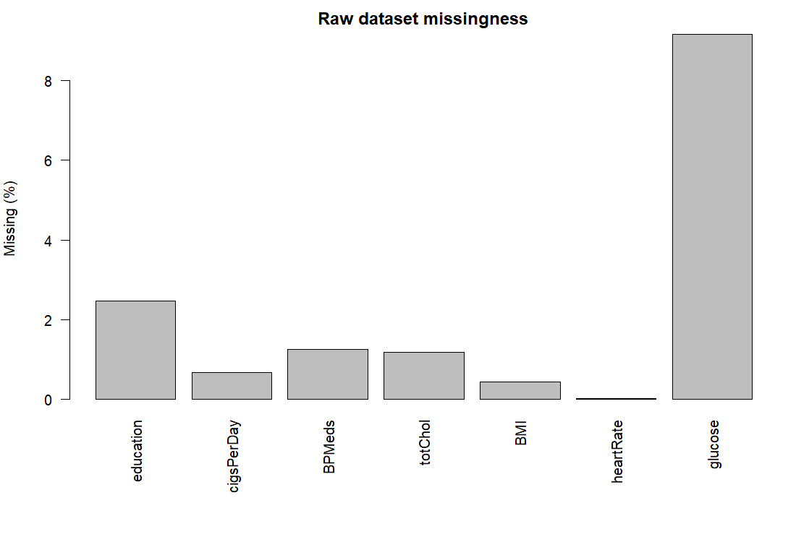
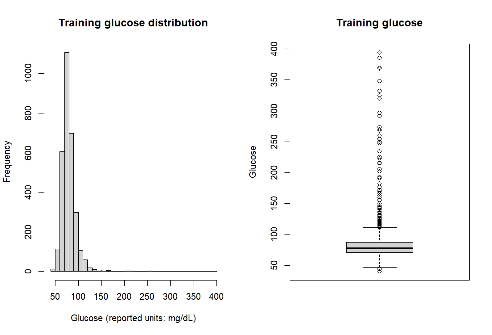
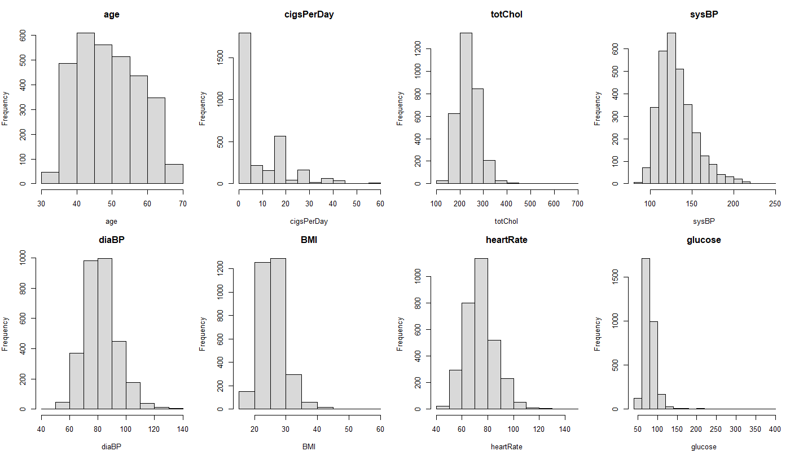
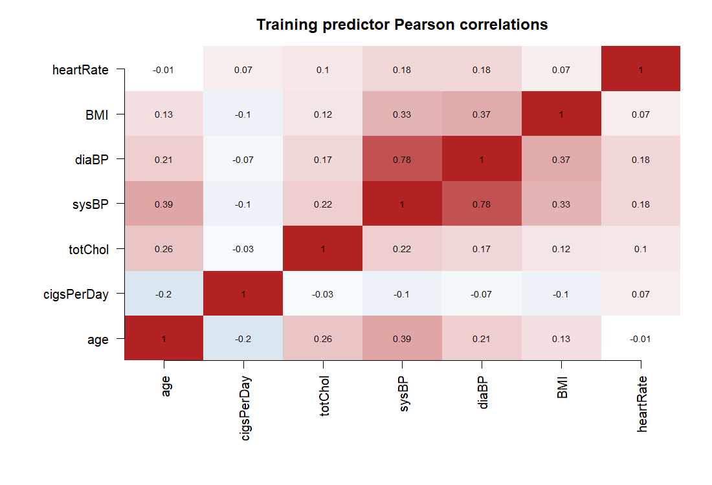
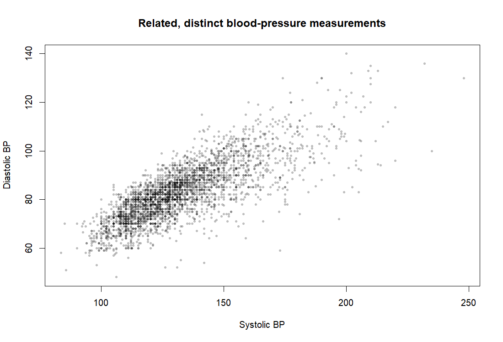
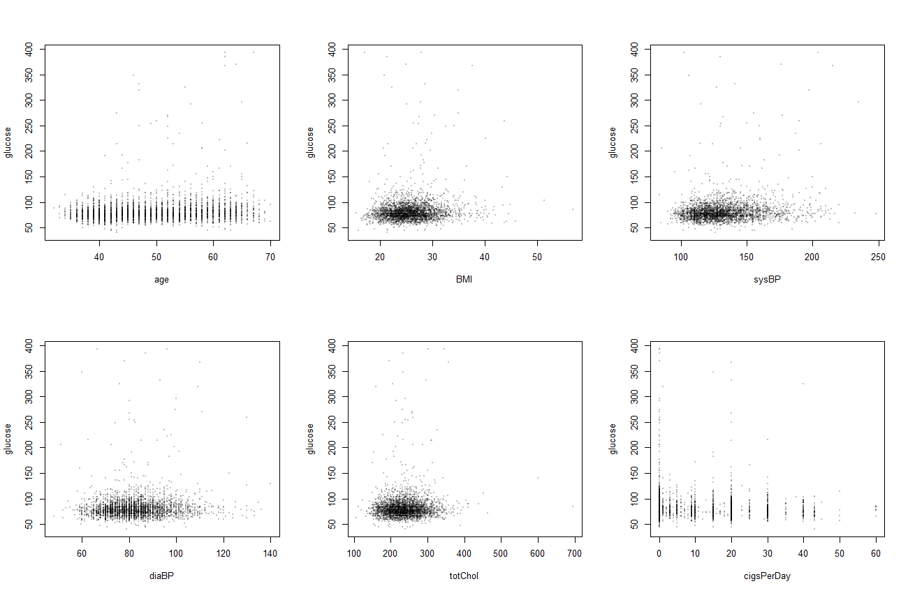
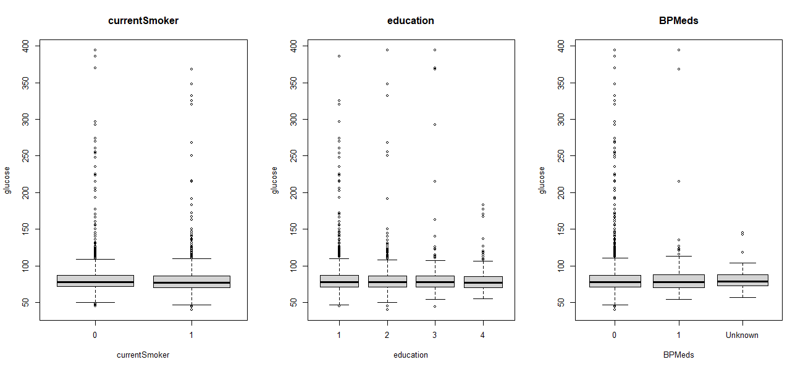

```{r setup, include=FALSE}
knitr::opts_chunk$set(echo=TRUE, warning=TRUE, message=FALSE)
# Run from the milestone folder. All transformations are defined here.
options(stringsAsFactors = FALSE)
for (p in c('data/cleaned','supporting/handoff','supporting/outputs','supporting/figures')) dir.create(p, recursive=TRUE, showWarnings=FALSE)
raw <- read.csv('data/raw/framingham.csv', na.strings=c('NA','','N/A','?'))
stopifnot(nrow(raw)==4240L, ncol(raw)==16L)
raw$source_row <- seq_len(nrow(raw))
write_out <- function(x, name) write.csv(x, file.path('supporting/outputs',name), row.names=FALSE, na='')
missing_table <- data.frame(variable=names(raw), missing=colSums(is.na(raw)), percent=100*colMeans(is.na(raw)))
write_out(missing_table,'missingness_raw.csv')
binary <- c('male','currentSmoker','BPMeds','prevalentStroke','prevalentHyp','diabetes','TenYearCHD')
checks <- data.frame(check=c('Exact duplicate original rows','Invalid binary codes','Invalid education codes','Nonpositive medical measurements','Negative cigarettes/day','Systolic <= diastolic','Nonsmoker with positive cigarettes','Smoker with zero cigarettes'),
 count=c(sum(duplicated(raw[setdiff(names(raw),'source_row')])),
 sum(sapply(raw[binary],function(x)sum(!is.na(x)&!x%in%c(0,1)))),
 sum(!is.na(raw$education)&!raw$education%in%1:4),
 sum(sapply(raw[c('age','totChol','sysBP','diaBP','BMI','heartRate','glucose')],function(x)sum(x<=0,na.rm=TRUE))),
 sum(raw$cigsPerDay<0,na.rm=TRUE),sum(raw$sysBP<=raw$diaBP,na.rm=TRUE),
 sum(raw$currentSmoker==0&raw$cigsPerDay>0,na.rm=TRUE),sum(raw$currentSmoker==1&raw$cigsPerDay==0,na.rm=TRUE)))
write_out(checks,'validity_checks.csv')
# Stop on definite schema/range errors; report smoking combinations without rewriting.
stopifnot(all(checks$count[1:6]==0))
removed <- raw[is.na(raw$glucose),]
observed <- raw[!is.na(raw$glucose),]
write_out(removed,'excluded_missing_glucose.csv')
selection <- do.call(rbind,lapply(c('age','male','currentSmoker','BMI','sysBP','diabetes'),function(v){
 a<-raw[!is.na(raw$glucose),v]; b<-raw[is.na(raw$glucose),v]
 data.frame(variable=v,observed_target_mean=mean(a,na.rm=TRUE),missing_target_mean=mean(b,na.rm=TRUE),
 standardized_difference=(mean(a,na.rm=TRUE)-mean(b,na.rm=TRUE))/sqrt((var(a,na.rm=TRUE)+var(b,na.rm=TRUE))/2))}))
write_out(selection,'target_missingness_comparison.csv')
pattern <- as.data.frame(table(rowSums(is.na(raw[setdiff(names(raw),'source_row')]))))
names(pattern)<-c('missing_fields_per_row','rows');write_out(pattern,'missing_fields_per_row.csv')

# Deterministic split membership before fitting preprocessing. This is an
# exploratory holdout: prior project inspection used all rows, as disclosed.
set.seed(262)
train_rows <- sort(sample(seq_len(nrow(observed)),floor(.8*nrow(observed))))
split <- rep('test',nrow(observed));split[train_rows]<-'train'
base <- observed[setdiff(names(observed),c('diabetes','TenYearCHD'))]
train <- base[split=='train',];test <- base[split=='test',]
write.csv(train,'supporting/handoff/train_unimputed.csv',row.names=FALSE,na='')
write.csv(test,'supporting/handoff/test_unimputed.csv',row.names=FALSE,na='')
write_out(data.frame(source_row=base$source_row,split=split),'split_manifest.csv')

mode_value <- function(x) as.numeric(names(sort(table(x),decreasing=TRUE))[1])
fit_preprocessor <- function(d){
 # Numeric distances use continuous measurements plus fixed 0/1 indicators.
 # Education codes and medication unknowns are excluded from distances.
 distance_cols <- c('male','age','currentSmoker','cigsPerDay','prevalentStroke','prevalentHyp','totChol','sysBP','diaBP','BMI','heartRate')
 mu<-sapply(d[distance_cols],mean,na.rm=TRUE);sdv<-sapply(d[distance_cols],sd,na.rm=TRUE);sdv[!is.finite(sdv)|sdv==0]<-1
 list(donors=d,cols=distance_cols,mu=mu,sd=sdv,
      heart=median(d$heartRate,na.rm=TRUE),education=mode_value(d$education),
      cigarettes=median(d$cigsPerDay[d$currentSmoker==1],na.rm=TRUE),k=10L)
}
knn_values <- function(query,fit,target){
 donors<-fit$donors;cols<-setdiff(fit$cols,target)
 z<-sweep(sweep(as.matrix(donors[cols]),2,fit$mu[cols],'-'),2,fit$sd[cols],'/')
 vapply(seq_len(nrow(query)),function(i){
  q<-(as.numeric(query[i,cols])-fit$mu[cols])/fit$sd[cols]
  delta<-sweep(z,2,q,'-');available<-rowSums(!is.na(delta))
  dist<-rowSums(delta^2,na.rm=TRUE)*length(cols)/pmax(available,1)
  dist[available==0|is.na(donors[[target]])]<-Inf
  ids<-head(order(dist,donors$source_row),fit$k);ids<-ids[is.finite(dist[ids])]
  if(length(ids))mean(donors[[target]][ids]) else median(donors[[target]],na.rm=TRUE)
 },numeric(1))
}
apply_preprocessor <- function(d,fit){
 out<-d
 for(v in c('education','BMI','totChol','cigsPerDay','heartRate'))out[[paste0(v,'_missing')]]<-as.integer(is.na(d[[v]]))
 # Both KNN imputations use original queries/donors, avoiding order effects.
 for(v in c('BMI','totChol')){
  ids<-which(is.na(d[[v]]));if(length(ids))out[ids,v]<-knn_values(d[ids,],fit,v)
 }
 out$heartRate[is.na(out$heartRate)]<-fit$heart
 out$education[is.na(out$education)]<-fit$education
 ids<-which(is.na(out$cigsPerDay));out$cigsPerDay[ids]<-ifelse(out$currentSmoker[ids]==0,0,fit$cigarettes)
 out$BPMeds<-ifelse(is.na(d$BPMeds),'Unknown',as.character(d$BPMeds))
 # Candidate derived feature; omitted from the primary modeling CSV because it
 # is an exact linear combination of sysBP and diaBP.
 stopifnot(!anyNA(out),all(out$glucose==d$glucose),all(out$education%in%1:4),all(out$BPMeds%in%c('0','1','Unknown')))
 out
}
fit<-fit_preprocessor(train)
clean<-apply_preprocessor(base,fit)
saveRDS(fit,'supporting/outputs/preprocessor.rds')
write.csv(clean,'data/cleaned/framingham_cleaned.csv',row.names=FALSE)
write.csv(clean[split=='train',],'supporting/handoff/train_cleaned.csv',row.names=FALSE)
write.csv(clean[split=='test',],'supporting/handoff/test_cleaned.csv',row.names=FALSE)
candidate<-data.frame(source_row=clean$source_row,pulse_pressure=clean$sysBP-clean$diaBP)
write.csv(candidate,'supporting/candidate_pulse_pressure.csv',row.names=FALSE)
write_out(data.frame(parameter=c('heartRate_median','education_mode','smoker_cigarettes_median','knn_k'),value=c(fit$heart,fit$education,fit$cigarettes,fit$k)),'imputation_parameters.csv')

# Cell-level audit: every filled value retains its original source row.
audit<-do.call(rbind,lapply(c('heartRate','education','BMI','totChol','cigsPerDay','BPMeds'),function(v){
 ids<-which(is.na(base[[v]]));data.frame(source_row=base$source_row[ids],variable=v,old_value=NA_character_,new_value=as.character(clean[ids,v]))}))
write_out(audit,'imputed_cells.csv')
numeric_vars<-c('age','cigsPerDay','totChol','sysBP','diaBP','BMI','heartRate','glucose')
summaries<-do.call(rbind,lapply(numeric_vars,function(v){x<-train[[v]];x<-x[!is.na(x)];q<-quantile(x,c(.25,.5,.75));s<-sd(x)
data.frame(variable=v,n=length(x),mean=mean(x),sd=s,min=min(x),q1=q[1],median=q[2],q3=q[3],max=max(x),skewness=mean((x-mean(x))^3)/s^3)}))
rownames(summaries)<-NULL;write_out(summaries,'training_numerical_summary.csv')
flags<-do.call(rbind,lapply(numeric_vars,function(v){x<-observed[[v]];q<-quantile(train[[v]],c(.25,.75),na.rm=TRUE);iq<-diff(q);lo<-q[1]-1.5*iq;hi<-q[2]+1.5*iq
ids<-which(x<lo|x>hi);data.frame(source_row=observed$source_row[ids],variable=rep(v,length(ids)),value=x[ids],lower=rep(as.numeric(lo),length(ids)),upper=rep(as.numeric(hi),length(ids)))}))
write_out(flags,'outlier_flags_retained.csv')
ct<-clean[split=='train',]
continuous<-c('age','cigsPerDay','totChol','sysBP','diaBP','BMI','heartRate')
correlation<-cor(ct[continuous]);write.csv(correlation,'supporting/outputs/pearson_predictor_matrix.csv')
pairs<-which(upper.tri(correlation),arr.ind=TRUE)
pair_table<-data.frame(feature1=rownames(correlation)[pairs[,1]],feature2=colnames(correlation)[pairs[,2]],r=correlation[pairs])
write_out(pair_table[order(-abs(pair_table$r)),],'pearson_pairs.csv')
vif<-data.frame(variable=continuous,VIF=sapply(continuous,function(v){m<-lm(reformulate(setdiff(continuous,v),response=v),data=ct);1/(1-summary(m)$r.squared)}))
write_out(vif,'continuous_predictor_vif.csv')
review_pairs<-data.frame(feature1=c('sysBP','currentSmoker','prevalentHyp','prevalentHyp'),feature2=c('diaBP','cigsPerDay','sysBP','diaBP'))
review_pairs$r<-mapply(function(a,b)cor(ct[[a]],ct[[b]]),review_pairs$feature1,review_pairs$feature2)
review_pairs$decision<-'Retain both provisionally'
review_pairs$reason<-c('Distinct pressure measurements; inspect VIF and validate alternatives.',
 'Smoking status and daily intensity have different interpretations; test whether status adds value.',
 'Recorded hypertension status and current pressure need not coincide; confirm definition.',
 'Recorded hypertension status and current pressure need not coincide; confirm definition.')
write_out(review_pairs,'collinearity_decisions.csv')
# Extend the diagnostic to the encoded primary predictor design, excluding ID,
# target, and constant columns. Values are per-column VIFs, not categorical GVIFs.
design_data<-ct[setdiff(names(ct),c('source_row','glucose'))]
design_data$education<-factor(design_data$education,levels=1:4)
design_data$BPMeds<-factor(design_data$BPMeds,levels=c('0','1','Unknown'))
design<-model.matrix(~.,data=design_data)[,-1,drop=FALSE]
constant_design<-colnames(design)[apply(design,2,function(x)length(unique(x))<2)]
design<-design[,apply(design,2,function(x)length(unique(x))>1),drop=FALSE]
design_vif<-data.frame(encoded_column=colnames(design),VIF=vapply(seq_len(ncol(design)),function(j){
 y<-design[,j];x<-cbind(1,design[,-j,drop=FALSE]);m<-lm.fit(x,y);r2<-1-sum(m$residuals^2)/sum((y-mean(y))^2)
 if(1-r2<1e-12)Inf else 1/(1-r2)
},numeric(1)))
write_out(design_vif,'encoded_design_vif.csv')
redundancy_check<-data.frame(check='BPMeds_missing equals BPMeds Unknown dummy',exact_duplicate=all(as.integer(is.na(train$BPMeds))==as.integer(ct$BPMeds=='Unknown')),decision='Remove BPMeds_missing; retain Unknown category')
write_out(redundancy_check,'removed_redundant_feature.csv')
association<-data.frame(variable=continuous,pearson=sapply(continuous,function(v)cor(ct[[v]],ct$glucose)),spearman=sapply(continuous,function(v)cor(ct[[v]],ct$glucose,method='spearman')))
write_out(association,'training_target_associations.csv')
education_spearman<-cor(ct$education[ct$education_missing==0],ct$glucose[ct$education_missing==0],method='spearman')
category_counts<-do.call(rbind,lapply(c('male','education','currentSmoker','BPMeds','prevalentStroke','prevalentHyp'),function(v){t<-table(ct[[v]]);data.frame(variable=v,level=names(t),count=as.integer(t),percent=100*as.numeric(t)/sum(t))}))
write_out(category_counts,'training_category_counts.csv')
categorical_overlap<-function(a,b){
 tab<-table(a,b);p<-tab/sum(tab);pa<-rowSums(p);pb<-colSums(p)
 expected<-outer(pa,pb);nz<-p>0;mi<-sum(p[nz]*log(p[nz]/expected[nz]));ha<- -sum(pa[pa>0]*log(pa[pa>0]));hb<- -sum(pb[pb>0]*log(pb[pb>0]))
 test<-suppressWarnings(chisq.test(tab));data.frame(chi_square=unname(test$statistic),p_value=test$p.value,NMI=if(ha+hb>0)2*mi/(ha+hb) else 0,min_expected=min(test$expected))
}
overlap<-categorical_overlap(ct$prevalentHyp,ct$BPMeds);write_out(overlap,'categorical_overlap.csv')
png_plot<-function(name,code,width=1100,height=750){png(file.path('supporting/figures',name),width=width,height=height,res=120);on.exit(dev.off());force(code)}
png_plot('missingness.png',{m<-missing_table[missing_table$missing>0,];par(mar=c(8,4,2,1));barplot(m$percent,names.arg=m$variable,las=2,ylab='Missing (%)',main='Raw dataset missingness')})
png_plot('glucose_distribution.png',{par(mfrow=c(1,2));hist(train$glucose,breaks=35,main='Training glucose distribution',xlab='Glucose (reported units: mg/dL)');boxplot(train$glucose,main='Training glucose',ylab='Glucose')})
png_plot('predictor_distributions.png',{par(mfrow=c(2,4),mar=c(4,4,3,1));for(v in numeric_vars)hist(train[[v]],main=v,xlab=v,col='grey85')},1400,800)
png_plot('glucose_relationships.png',{par(mfrow=c(2,3));for(v in c('age','BMI','sysBP','diaBP','totChol','cigsPerDay'))plot(ct[[v]],ct$glucose,pch=16,cex=.35,col=adjustcolor('black',.25),xlab=v,ylab='glucose')},1300,850)
png_plot('correlations.png',{par(mar=c(8,8,3,2));image(seq_along(continuous),seq_along(continuous),correlation,zlim=c(-1,1),col=colorRampPalette(c('steelblue','white','firebrick'))(101),axes=FALSE,xlab='',ylab='',main='Training predictor Pearson correlations');axis(1,seq_along(continuous),continuous,las=2);axis(2,seq_along(continuous),continuous,las=2);for(i in seq_along(continuous))for(j in seq_along(continuous))text(i,j,round(correlation[i,j],2),cex=.7)})
png_plot('categorical_glucose.png',{par(mfrow=c(1,3));for(v in c('currentSmoker','education','BPMeds'))boxplot(ct$glucose~factor(ct[[v]]),main=v,xlab=v,ylab='glucose')},1300,600)
png_plot('blood_pressure_overlap.png',{plot(ct$sysBP,ct$diaBP,pch=16,cex=.5,col=adjustcolor('black',.25),xlab='Systolic BP',ylab='Diastolic BP',main='Related, distinct blood-pressure measurements')})
flow<-data.frame(stage=c('Raw rows','Excluded missing glucose','Retained observed targets','Training rows','Test rows','Imputed cells','Final columns'),n=c(nrow(raw),nrow(removed),nrow(clean),sum(split=='train'),sum(split=='test'),nrow(audit),ncol(clean)))
write_out(flow,'cleaning_flow.csv')
capture.output(sessionInfo(),file='supporting/outputs/sessionInfo.txt')
cat('Completed:',nrow(clean),'rows;',ncol(clean),'columns;',nrow(audit),'filled cells.\n')

show_table <- function(x, digits=3) knitr::kable(x, digits=digits, row.names=FALSE)
```

# Topic, problem, and objective

We investigate whether demographic, behavioral, and cardiovascular measurements
can predict an individual's measured glucose level. Glucose is continuous, so the
later Python task is regression. The intended prediction occurs before the glucose
result is available, using other examination information. This is an educational
prediction study; associations do not establish causes.

This milestone documents inspection, cleaning, candidate feature engineering,
preliminary selection, and exploratory analysis. It exports the exact data to be
used in Python, alongside an audit trail and reproducible preprocessing functions.

# Dataset, provenance, and principal variables

The supplied input is `archive.zip`, containing `framingham.csv`: 4,240 observations
and 16 variables. The input CSV is copied byte-for-byte to `data/raw/` and never
overwritten. It is a commonly distributed Framingham teaching extract. The exact
original download page and redistribution license were not supplied; the team must
confirm these before final submission. We do not claim this is the complete original
Framingham cohort or independently establish its examination dates.

MIT OpenCourseWare describes this same 4,240-row, 16-variable schema, with risk
factors collected at the first examination and CHD measured in the following ten
years. See [MIT course transcript](https://ocw.mit.edu/courses/15-071-the-analytics-edge-spring-2017/a21d6ac42e8b2bb03204d4a50660a026_0x4PfWpy-ls.pdf).
The [Framingham Heart Study](https://www.framinghamheartstudy.org/) supplies study
background, but does not authenticate the supplied archive's exact provenance.

```{r dictionary}
dictionary <- read.csv('supporting/data_dictionary.csv')
show_table(dictionary)
```

Conventional units and education labels are documented as teaching-extract
conventions rather than verified metadata embedded in this CSV. Fasting status is
not established. `source_row` is an added audit identifier, not an original patient
identifier and never a predictor.

# Import and diagnosis

The complete executable cleaning and export code is embedded in this document
and shown in the appendix. The following outputs are generated from that code during
each render, not manually entered.

```{r inspection}
dim(raw[setdiff(names(raw),'source_row')])
str(raw)
show_table(head(raw))
show_table(missing_table)
show_table(checks)
show_table(pattern)
```



There are `r checks$count[1]` exact duplicates. Binary and ordinal codes and basic
positivity/pressure ordering are checked. A smoker reporting zero cigarettes is
flagged for contextual review rather than overwritten: definitions or timing may
explain the combination. We have no evidence supporting a correction to an
observed value. Broad statistical extremes are investigated below, separately
from definite invalid codes.

# Missing targets and selection effects

Rows missing glucose cannot supply observed regression labels and are excluded
from supervised analysis. Targets are not imputed. This removes `r nrow(removed)`
rows (`r round(100*nrow(removed)/nrow(raw),2)`%) and retains `r nrow(observed)`.
The excluded rows are retained in a separate audit file.

```{r selection}
show_table(selection)
show_table(data.frame(variable=names(base),missing=colSums(is.na(base))))
```

The observed-target group is `r round(100*mean(observed$male),1)`% recorded male,
compared with `r round(100*mean(removed$male),1)`% among missing-target rows.
This is a concrete warning that exclusion changes sample composition.

Differences between groups are descriptive evidence to examine, not proof of a
missingness mechanism. Missing at random cannot be established from these tables.
Exclusion can cause selection bias if glucose measurement relates to health or
collection practices. We explicitly retain this limitation.

# Imputation evidence and decisions

An earlier exploratory Python experiment compared median/mode against numerical
KNN with 3, 5, and 10 neighbors over five random donor/evaluation splits. Known
evaluation values were hidden; scaling and donors came only from the donor sample.
The experiment excludes glucose, diabetes, and future CHD from imputation inputs.
For cigarettes it restricts the experiment to smokers. Its script and all scores
are included under `supporting/experiments/`.

```{r imputation-comparison}
comparison <- read.csv('supporting/experiments/summary.csv')
show_table(comparison)
```

KNN-10 modestly improved BMI and cholesterol reconstruction. Median performed
better for heart rate; smoker-specific median had lower cigarettes MAE while
KNN-10 had lower RMSE. We choose the simpler median for cigarette intensity.
Rounded numerical KNN did not recover education categories well. Its categorical
test is only an approximation, not a dedicated categorical-neighbor algorithm.
Medication accuracy was misleading because approximately 97% are non-users;
balanced accuracy was near chance. We preserve medication uncertainty explicitly.

| Variable | Treatment | Rationale |
|---|---|---|
| glucose | Exclude missing-target rows | Do not manufacture regression labels |
| BMI, totChol | Standardized numerical KNN, k=10 | Preliminary reconstruction evidence |
| heartRate | Training median | One missing value; baseline outperformed KNN |
| cigsPerDay | Training smoker median; zero only for missing nonsmokers | Respect smoking status |
| education | Training mode plus missingness indicator | Preserve valid codes and record uncertainty |
| BPMeds | Explicit Unknown category | Avoid treating unknown medication as observed non-use |

We retain original-missingness indicators except for BPMeds, whose Unknown
category already carries that information. Sparse
indicators may be unhelpful; Python must evaluate them inside validation. They are
not evidence that missingness is informative.

**Limits of the comparison:** randomly hiding known values may not reproduce real
missingness. Five evaluation samples overlap, so their variability is not an
independent-sample confidence interval. The included experiment was rerun with the
same continuous/binary distance-feature choices as the final R implementation.
Encoding binary predictors in Euclidean distance is a mixed-type simplification.
Therefore these recommendations
remain provisional until the full Python pipeline is validated. KNN is not claimed
to be universally optimal.

# Leakage-aware preprocessing and export

We fix an 80/20 split with R seed 262 before estimating imputation values. Medians,
mode, KNN centering, scales, and donors use training rows only. KNN uses available
standardized features, adjusts distance for the number jointly observed, averages
10 eligible donors, and has a training-median fallback. Original observed values
are preserved. Binary indicators and quantitative measurements contribute to
Euclidean distances; this assumption needs sensitivity analysis.

```{r parameters}
show_table(read.csv('supporting/outputs/imputation_parameters.csv'))
show_table(flow)
show_table(head(audit,12))
```

The combined cleaned CSV is suitable for inspecting the result and final holdout
fitting using the supplied split. It must **not** be randomly split again for CV:
pre-imputed training rows would leak donor/parameter information between folds.
For model selection, Python must read `train_unimputed.csv`, fit the complete
preprocessing workflow separately within each fold, then refit on all training
rows and evaluate `test_unimputed.csv` once. Use the exported split manifest;
Python's seed alone will not recreate R's split.

Previous full-data inspection and imputation screening included all observed-target
rows before this split. The test subset is therefore an **exploratory holdout**,
not a pristine independent confirmation set. A new external dataset is required
for an unbiased independent assessment. This limitation is not repaired by making
a new random split of the same already-inspected data.

# Outliers, transformations, and consistency

```{r distributions}
show_table(summaries)
show_table(as.data.frame(table(flags$variable)))
```





Glucose has a long right tail. High values can represent the cases our model most
needs to predict. IQR fences use training observations and flag possible outliers;
they do not demonstrate measurement errors. All flagged values are retained and
exported with source-row identifiers for review. No unsupported winsorization,
deletion of extreme glucose, or clinical threshold correction is performed.

The ordinary three-sigma rule is not our default for skewed glucose. We report
medians/IQR as well as means/SD. A log-target model is a later candidate rather than
an automatic cleaning step; it must be evaluated in original glucose units, with
attention to back-transformation bias and high-glucose errors. Continuous
predictors are preserved rather than binned because arbitrary bins discard detail.

# Preliminary feature selection and engineering

`TenYearCHD` is removed because the future outcome is unavailable when baseline
glucose is predicted. `diabetes` is conservatively excluded: its derivation and
timing are unresolved and it can incorporate glucose-based diagnostic criteria.
This exclusion prevents an apparently strong predictor from making the task
circular. It can only be reconsidered if documentation establishes genuinely prior
diagnosis available at prediction time. Excluded original columns remain in raw data.

`education` remains an ordered category encoded 1-4 in CSV; Python should compare
ordinal handling with categorical encoding instead of assuming equal effects of
successive levels. `BPMeds` has fixed levels 0, 1, Unknown. With an intercept,
reference coding uses k-1 indicators. Original binary columns remain 0/1.

```{r overlap}
show_table(pair_table[order(-abs(pair_table$r)),])
show_table(vif)
show_table(overlap)
```





Pearson investigates pairwise linear overlap. VIF above 5 or 10 and absolute
correlation near 0.8 prompt investigation, not automatic deletion. The displayed
VIF diagnostic concerns continuous predictors only; the full encoded design must
be checked during linear-model development. Smoking status and smoking intensity
are also conceptually related. Systolic and diastolic BP measure distinct properties,
so they are retained pending validation. Chi-square significance is separated from
NMI shared-information strength; sparse expected cells limit chi-square inference.

Pulse pressure (`sysBP - diaBP`) is exported as a candidate feature in a separate
keyed CSV. It is omitted from the primary model table to avoid exact dependence
with both original blood pressures. Compare a replacement feature set in Python.
No target-based p-value threshold is used to delete predictors. Rare stroke and
medication categories are retained, with uncertainty explicitly acknowledged.

## Explicit Pearson collinearity review and keep/remove decisions

Predictor-predictor correlation addresses overlapping inputs. Correlation with
glucose instead addresses univariate target association; it does not diagnose
multicollinearity. We use the cleaned training sample consistently, so these
numbers can differ slightly from the earlier full-raw-data screen.

```{r collinearity-decisions}
show_table(review_pairs)
show_table(design_vif)
show_table(redundancy_check)
constant_design
```

Pearson between a binary indicator and a numerical measurement is a point-biserial
correlation. Thus the smoking and hypertension pairs can be interpreted without
pretending those binary indicators are continuous measurements. Education is
excluded from the continuous Pearson matrix because equal spacing is not assured.

The encoded-design VIF table extends the original continuous-only diagnostic to
binary predictors, reference-coded education/medication, and nonconstant
missingness indicators. These are individual design-column VIFs rather than
multi-degree-of-freedom GVIFs. Constant columns are listed and excluded from this
diagnostic because they cannot explain variation. In particular, a BPMeds_missing
indicator would duplicate BPMedsUnknown exactly. We therefore remove that extra
indicator from the cleaned CSV and retain the Unknown category. The cell-level
audit still records every originally missing medication value. The displayed VIF
table is for the resulting design after removing that exact redundancy.

**Decision for blood pressure:** retain sysBP and diaBP in the primary dataset.
Their correlation of `r round(review_pairs$r[1],3)` indicates shared information,
not interchangeable measurements. The continuous-only VIFs are below 5. The
broader design table identifies any additional overlap from hypertension and
other inputs and will inform model-specific handling in Python.

**Should pulse pressure replace them?** Pulse pressure alone loses information:
120/80 and 160/120 both give 40. Keeping sysBP plus pulse pressure preserves the
same two-dimensional information as sysBP plus diaBP, so ordinary unpenalized
linear regression has the same prediction space. It is a reparameterization,
not an automatic improvement. Keeping all three creates exact dependence.
We export the candidate separately and defer choosing a reduced representation
to training-fold validation. PCA could reduce dimensions, but would sacrifice
direct interpretability and is not justified solely by this pairwise correlation.

**Decision for smoking:** retain both status and intensity provisionally. Their
correlation is `r round(review_pairs$r[2],3)`; test cigarettes alone versus both
within Python validation. A threshold alone does not establish redundancy.

**Decision for hypertension:** retain status alongside pressure pending definition
checks and validation. Their correlations are
`r round(review_pairs$r[3],3)` and `r round(review_pairs$r[4],3)`.
An indicator and a current measurement can differ because of definitions or
measurement timing; the supplied data alone do not establish those explanations.

**Variables removed now:** TenYearCHD and diabetes are excluded for information
availability/leakage concerns, not because of a Pearson threshold. No original
predictor is deleted solely because it has a small p-value or high correlation.

# Exploratory relationships and group summaries

```{r association}
show_table(association)
education_spearman
show_table(category_counts)
```





These associations describe the development sample, not causal effects. Inspect
Pearson together with rank correlation and plots because a few extreme glucose
values can influence linear associations. Education uses Spearman on originally
observed categories, excluding its imputed values for this descriptive statistic.
The small size of some clinical subgroups makes their patterns unstable. Weak
univariate association does not establish that a feature lacks predictive value
in a nonlinear or multivariable model.

In the cleaned training sample, systolic/diastolic BP correlation is
`r round(correlation['sysBP','diaBP'],3)` and their VIFs are
`r round(vif$VIF[vif$variable=='sysBP'],2)` and
`r round(vif$VIF[vif$variable=='diaBP'],2)`. Neither exceeds 5 in this continuous
predictor diagnostic, supporting retention rather than automatic removal.
The largest absolute continuous-predictor Pearson correlation with glucose is
`r round(max(abs(association$pearson)),3)`, indicating limited univariate linear
signal after excluding potentially circular diabetes status. This motivates
realistic expectations, strong baselines, and nonlinear comparisons in Python.

# Main patterns, limitations, and modeling questions

The glucose distribution is concentrated near its median with a small high-value
tail; average-error metrics can hide poor performance in that tail. Related BP
measurements and smoking variables share information, but are not exact duplicates.
Missing glucose is the largest source of row loss. Small predictor missingness
does not establish that it is random, and imputation does not recover known truth.

The historical, geographically restricted teaching sample may not represent modern
populations or other regions. Category imbalance, uncertain measurement protocols,
unverified exact archive provenance, unknown medication details, and potential
selection from missing targets limit generalization. There is no supplied patient
identifier to assess repeated individuals or grouping. Source-row numbers are
traceability keys only. No clinical decision claim is supported.

For Milestone 2: compare training-mean/median baselines, linear regression,
regularized regression, and appropriately tuned nonlinear models using the same
folds. Compare median against KNN within folds, evaluate original and pulse-pressure
feature sets, and examine whether missingness indicators help. Report MAE, RMSE,
R-squared, fold variability, residual plots, high-glucose errors, and errors by age
and recorded sex. Consider paired bootstrap uncertainty for model comparisons.
Use an untouched external dataset if available, given the exploratory-holdout caveat.

# Reproduction and exported deliverables

Open this R Markdown in RStudio and click Knit to regenerate the report, cleaned
dataset, diagnostics, and figures. All R cleaning code is embedded in this file.
Supporting experiments, audit files, split data, and figures are under `supporting/`.
The Python screening experiment is supplemental; its results are included here.

```{r exports}
show_table(head(clean,10))
stopifnot(nrow(clean)==3852L,!anyNA(clean),!anyDuplicated(clean$source_row))
sessionInfo()
```

# Appendix: complete executable R cleaning and EDA code

```{r code-listing, results='asis', echo=FALSE}
embedded <- readLines('Milestone_1.Rmd', warn=FALSE)
start <- grep('^```\\{r setup', embedded)[1] + 1L
finish <- which(seq_along(embedded) > start & embedded == '```')[1] - 1L
cat('```r\n', paste(embedded[start:finish], collapse='\n'), '\n```\n', sep='')
```

