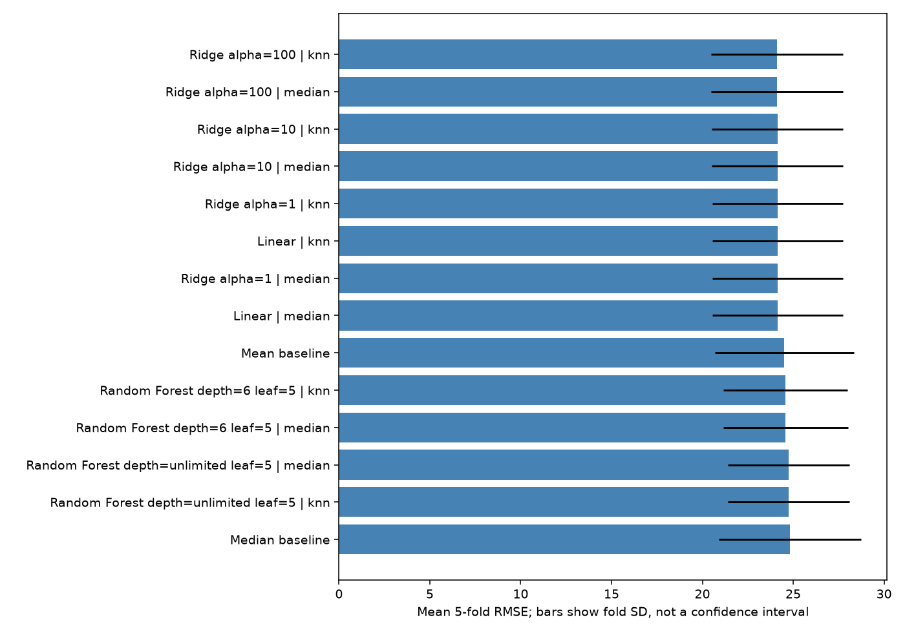
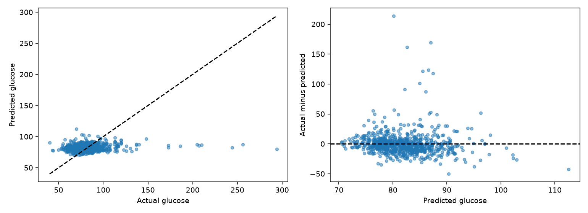
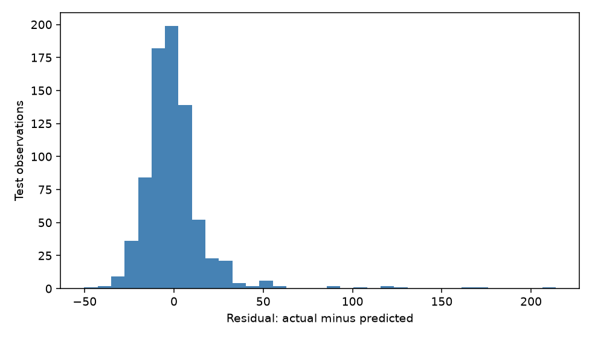

# Milestone 2: Glucose Modeling and Evaluation

## Objective and connection to Milestone 1

Predict measured glucose from 13 permitted demographic, behavioral and examination inputs. This is supervised regression. The original CSV has 4,240 rows; 388 missing targets were excluded in R, leaving 3,852. The supplied R split is 3,081 development and 771 test rows. We start from the Milestone 1 pre-imputation handoff to refit preprocessing within folds. No clinical utility is claimed.

## Validation and preprocessing

Five shuffled K-fold splits, random seed 262, shared by every candidate. All medians, education mode, smoker median, KNN donor values, distance scales, and final linear-model scales are fitted only on each fold's training rows. BMI/cholesterol compare median versus standardized KNN-10. Heart rate uses median; cigarettes use smoker median; education uses mode; missing medication becomes Unknown. Five missingness flags are regenerated per fold. Fixed documented category levels use k-1 encoding; medication Unknown already represents missingness. Glucose, source_row, diabetes, and TenYearCHD never enter the features.

We use fixed candidate settings instead of a large search. Ridge alpha is compared at 1, 10, 100; Random Forest uses 150 trees, leaf size 5, and depth 6 or unlimited. No target transformation or engineered-feature search is added. Selection uses lowest mean fold RMSE, then MAE; this rule was saved before test-file loading. Selected CV scores can be optimistic after selection and are not independent final estimates.

## Earlier exploration: important limitation

<strong>The reserved test rows were previously exposed to EDA and exploratory imputation screening in Milestone 1. They are not a pristine independent confirmation set.</strong> This modeling run does not use them to fit preprocessing, compare candidates, tune settings, or select a winner. The prior exposure cannot be undone; external validation is needed for an independent claim.

## Baseline and regression metrics

The mean and median baselines ignore the inputs and predict the corresponding development-fold target constant. These are benchmarks, not clinical models. RMSE is primary because large glucose errors matter; MAE reports typical absolute error in original glucose units. R² measures squared-error improvement relative to the evaluation sample mean and can be negative. The fitted mean baseline comes from training and can itself have a negative held-out R². Classification accuracy and its binomial interval are inappropriate for continuous glucose.

## Cross-validation results

<table class="dataframe">
  <thead>
    <tr style="text-align: right;">
      <th>candidate</th>
      <th>MAE_mean</th>
      <th>MAE_sd</th>
      <th>RMSE_mean</th>
      <th>RMSE_sd</th>
      <th>R2_mean</th>
      <th>R2_sd</th>
    </tr>
  </thead>
  <tbody>
    <tr>
      <td>Ridge alpha=100 | knn</td>
      <td>12.5814</td>
      <td>0.8484</td>
      <td>24.1145</td>
      <td>3.6354</td>
      <td>0.0285</td>
      <td>0.0176</td>
    </tr>
    <tr>
      <td>Ridge alpha=100 | median</td>
      <td>12.5807</td>
      <td>0.8496</td>
      <td>24.1164</td>
      <td>3.6381</td>
      <td>0.0284</td>
      <td>0.0176</td>
    </tr>
    <tr>
      <td>Ridge alpha=10 | knn</td>
      <td>12.6387</td>
      <td>0.8275</td>
      <td>24.1366</td>
      <td>3.6053</td>
      <td>0.0263</td>
      <td>0.0215</td>
    </tr>
    <tr>
      <td>Ridge alpha=10 | median</td>
      <td>12.6377</td>
      <td>0.8286</td>
      <td>24.1385</td>
      <td>3.6082</td>
      <td>0.0262</td>
      <td>0.0214</td>
    </tr>
    <tr>
      <td>Ridge alpha=1 | knn</td>
      <td>12.6468</td>
      <td>0.8241</td>
      <td>24.1422</td>
      <td>3.6001</td>
      <td>0.0258</td>
      <td>0.0221</td>
    </tr>
    <tr>
      <td>Linear | knn</td>
      <td>12.6478</td>
      <td>0.8237</td>
      <td>24.1429</td>
      <td>3.5995</td>
      <td>0.0257</td>
      <td>0.0222</td>
    </tr>
    <tr>
      <td>Ridge alpha=1 | median</td>
      <td>12.6458</td>
      <td>0.8251</td>
      <td>24.1441</td>
      <td>3.6030</td>
      <td>0.0257</td>
      <td>0.0220</td>
    </tr>
    <tr>
      <td>Linear | median</td>
      <td>12.6467</td>
      <td>0.8247</td>
      <td>24.1448</td>
      <td>3.6024</td>
      <td>0.0256</td>
      <td>0.0221</td>
    </tr>
    <tr>
      <td>Mean baseline</td>
      <td>12.6111</td>
      <td>0.9866</td>
      <td>24.5090</td>
      <td>3.8266</td>
      <td>-0.0018</td>
      <td>0.0019</td>
    </tr>
    <tr>
      <td>Random Forest depth=6 leaf=5 | knn</td>
      <td>12.8458</td>
      <td>0.8706</td>
      <td>24.5630</td>
      <td>3.4160</td>
      <td>-0.0121</td>
      <td>0.0529</td>
    </tr>
    <tr>
      <td>Random Forest depth=6 leaf=5 | median</td>
      <td>12.8442</td>
      <td>0.8676</td>
      <td>24.5808</td>
      <td>3.4376</td>
      <td>-0.0133</td>
      <td>0.0517</td>
    </tr>
    <tr>
      <td>Random Forest depth=unlimited leaf=5 | median</td>
      <td>13.1638</td>
      <td>0.7917</td>
      <td>24.7369</td>
      <td>3.3464</td>
      <td>-0.0278</td>
      <td>0.0634</td>
    </tr>
    <tr>
      <td>Random Forest depth=unlimited leaf=5 | knn</td>
      <td>13.1817</td>
      <td>0.7931</td>
      <td>24.7435</td>
      <td>3.3355</td>
      <td>-0.0285</td>
      <td>0.0638</td>
    </tr>
    <tr>
      <td>Median baseline</td>
      <td>12.0278</td>
      <td>1.0168</td>
      <td>24.8066</td>
      <td>3.9113</td>
      <td>-0.0259</td>
      <td>0.0054</td>
    </tr>
  </tbody>
</table>
Selected: <strong>Ridge alpha=100 | knn</strong>. Best learned candidate: Ridge alpha=100 | knn. Fold SD is descriptive variation, not a 95% CI; folds share training observations. The selected learned model improves mean cross-validation RMSE over the mean baseline.

## Final exploratory-holdout evaluation

<table class="dataframe">
  <thead>
    <tr style="text-align: right;">
      <th>candidate</th>
      <th>MAE</th>
      <th>RMSE</th>
      <th>R2</th>
    </tr>
  </thead>
  <tbody>
    <tr>
      <td>Ridge alpha=100 | knn</td>
      <td>11.6862</td>
      <td>20.2223</td>
      <td>0.0267</td>
    </tr>
    <tr>
      <td>Mean baseline</td>
      <td>11.7634</td>
      <td>20.4978</td>
      <td>-0.0000</td>
    </tr>
    <tr>
      <td>Median baseline</td>
      <td>11.5175</td>
      <td>20.8932</td>
      <td>-0.0390</td>
    </tr>
  </tbody>
</table>
Only the frozen winner and the two predeclared baselines are reported on test data. No other candidate is selected using these results. Training and pooled OOF scores for the winner follow; training error is not a future-performance estimate.
<table class="dataframe">
  <thead>
    <tr style="text-align: right;">
      <th>sample</th>
      <th>MAE</th>
      <th>RMSE</th>
      <th>R2</th>
    </tr>
  </thead>
  <tbody>
    <tr>
      <td>training (optimistic)</td>
      <td>12.5071</td>
      <td>24.1599</td>
      <td>0.0464</td>
    </tr>
    <tr>
      <td>pooled out-of-fold</td>
      <td>12.5815</td>
      <td>24.3331</td>
      <td>0.0326</td>
    </tr>
  </tbody>
</table>

## Bootstrap 95% uncertainty intervals

<table class="dataframe">
  <thead>
    <tr style="text-align: right;">
      <th>metric</th>
      <th>lower_95</th>
      <th>upper_95</th>
    </tr>
  </thead>
  <tbody>
    <tr>
      <td>MAE</td>
      <td>10.5464</td>
      <td>12.8588</td>
    </tr>
    <tr>
      <td>RMSE</td>
      <td>16.1076</td>
      <td>24.3264</td>
    </tr>
    <tr>
      <td>R2</td>
      <td>-0.0109</td>
      <td>0.0582</td>
    </tr>
    <tr>
      <td>delta_MAE_vs_mean</td>
      <td>-0.3944</td>
      <td>0.2589</td>
    </tr>
    <tr>
      <td>delta_RMSE_vs_mean</td>
      <td>-0.5995</td>
      <td>0.0866</td>
    </tr>
    <tr>
      <td>delta_R2_vs_mean</td>
      <td>-0.0089</td>
      <td>0.0595</td>
    </tr>
  </tbody>
</table>
2,000 paired resamples of test observations and their fixed predictions, seed 262; percentile intervals. Deltas are selected-model metric minus training-mean-baseline metric, using the same resampled observations. Negative MAE/RMSE deltas and positive R² deltas favor the selected model. These are approximate sampling intervals conditional on the fitted model and this exploratory sample; they do not include refitting, tuning, training-sample, or prior-selection uncertainty. They assume independent representative observations; the supplied data do not establish that assumption.

## Error analysis and possible bias

<table class="dataframe">
  <thead>
    <tr style="text-align: right;">
      <th>group</th>
      <th>n</th>
      <th>MAE</th>
      <th>RMSE</th>
      <th>mean_residual</th>
    </tr>
  </thead>
  <tbody>
    <tr>
      <td>recorded female</td>
      <td>434</td>
      <td>11.7165</td>
      <td>22.5320</td>
      <td>1.2827</td>
    </tr>
    <tr>
      <td>recorded male</td>
      <td>337</td>
      <td>11.6472</td>
      <td>16.7860</td>
      <td>-1.5697</td>
    </tr>
    <tr>
      <td>age below 50</td>
      <td>408</td>
      <td>9.6851</td>
      <td>13.6904</td>
      <td>-0.7343</td>
    </tr>
    <tr>
      <td>age 50 or above</td>
      <td>363</td>
      <td>13.9354</td>
      <td>25.6500</td>
      <td>0.9017</td>
    </tr>
    <tr>
      <td>glucose above training 95th percentile</td>
      <td>42</td>
      <td>56.0220</td>
      <td>71.6198</td>
      <td>56.0220</td>
    </tr>
    <tr>
      <td>glucose at/below training 95th percentile</td>
      <td>729</td>
      <td>9.1319</td>
      <td>11.7040</td>
      <td>-3.1896</td>
    </tr>
  </tbody>
</table>
The high-glucose slice uses the development-target 95th percentile (108.00), not a diagnostic threshold. Slices are descriptive and may be small; differences do not prove discrimination or fairness. Extreme errors can dominate RMSE and are retained. No changes were made after inspecting test errors.

## Interpretation

Linear coefficients describe adjusted associations, not causal effects. Numerical inputs are standardized: their coefficients are per training standard deviation; category coefficients are relative to education level 1 and no BP medication. Small missingness groups and correlated inputs make coefficients unstable.
<table class="dataframe">
  <thead>
    <tr style="text-align: right;">
      <th>feature</th>
      <th>coefficient</th>
      <th>abs_coefficient</th>
    </tr>
  </thead>
  <tbody>
    <tr>
      <td>sysBP</td>
      <td>4.9188</td>
      <td>4.9188</td>
    </tr>
    <tr>
      <td>diaBP</td>
      <td>-3.3514</td>
      <td>3.3514</td>
    </tr>
    <tr>
      <td>heartRate</td>
      <td>1.9673</td>
      <td>1.9673</td>
    </tr>
    <tr>
      <td>BMI</td>
      <td>1.5433</td>
      <td>1.5433</td>
    </tr>
    <tr>
      <td>male</td>
      <td>1.4104</td>
      <td>1.4104</td>
    </tr>
    <tr>
      <td>age</td>
      <td>1.2952</td>
      <td>1.2952</td>
    </tr>
    <tr>
      <td>cigsPerDay</td>
      <td>-1.2952</td>
      <td>1.2952</td>
    </tr>
    <tr>
      <td>BPMeds_1</td>
      <td>1.0411</td>
      <td>1.0411</td>
    </tr>
    <tr>
      <td>education_3</td>
      <td>0.8159</td>
      <td>0.8159</td>
    </tr>
    <tr>
      <td>BMI_missing</td>
      <td>0.5585</td>
      <td>0.5585</td>
    </tr>
    <tr>
      <td>cigsPerDay_missing</td>
      <td>0.4165</td>
      <td>0.4165</td>
    </tr>
    <tr>
      <td>prevalentHyp</td>
      <td>-0.3971</td>
      <td>0.3971</td>
    </tr>
    <tr>
      <td>totChol_missing</td>
      <td>0.3483</td>
      <td>0.3483</td>
    </tr>
    <tr>
      <td>prevalentStroke</td>
      <td>-0.2145</td>
      <td>0.2145</td>
    </tr>
    <tr>
      <td>education_4</td>
      <td>-0.1618</td>
      <td>0.1618</td>
    </tr>
  </tbody>
</table>

## Conclusions, assumptions and next questions

The selected model has test MAE 11.69, RMSE 20.22, and R² 0.0267. The R² interval is [-0.0109, 0.0582]. The improvement is small: most variation remains unexplained. The paired RMSE difference interval versus the mean baseline is [-0.5995, 0.0866]; an interval crossing zero does not establish superiority. The median baseline has lower MAE than the selected model in this run, illustrating that the preferred choice depends on the predeclared metric. KNN versus median preprocessing differs negligibly in CV RMSE; this experiment does not justify a strong claim that KNN is better. This is an exploratory comparison, not evidence of accurate clinical prediction.

The selected learned model improves mean cross-validation RMSE over the mean baseline. Excluding diabetes avoids potential circularity but removes strong apparent signal. Weak linear associations, rare high-glucose cases, historical/geographic sampling, unknown fasting/treatment context, imputation assumptions, missing-target selection, uncertain provenance and license, and earlier full-data exploration limit conclusions. Source rows are not patient IDs; repeated-person dependence cannot be excluded from the supplied schema. Any future feature engineering or tuning must use development folds; these test results must not become a tuning target. An external sample is needed to establish transportability.

## Reproduction and lecture alignment

Run <code>python train.py</code> from this folder with the adjacent Milestone 1 folder present. Exact dependency versions, input hashes, fold membership, fold scores, leakage checks, predictions, bootstrap draws and serialized pipeline are under supporting/. Lecture 5 slides 35–46 cover regression metrics and R² intervals; slides 67–74 cover holdout and cross-validation; slides 75–78 distinguish bootstrap uncertainty from model selection. Lecture 4 slides 80–81 introduce regularization and Ridge. Bootstrap intervals here extend the lecture's fixed-prediction resampling approach to regression. Adjusted training R² is not used to rank a mixture of linear models, forests and baselines; unseen-data metrics are appropriate for that comparison.

